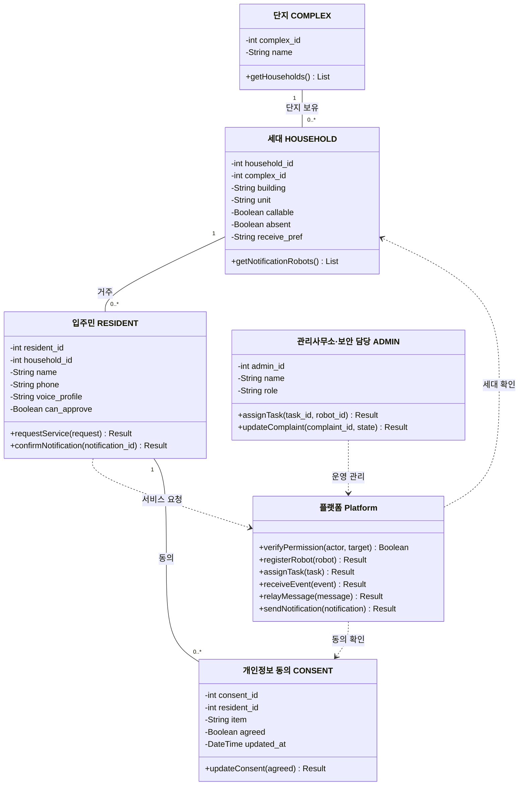
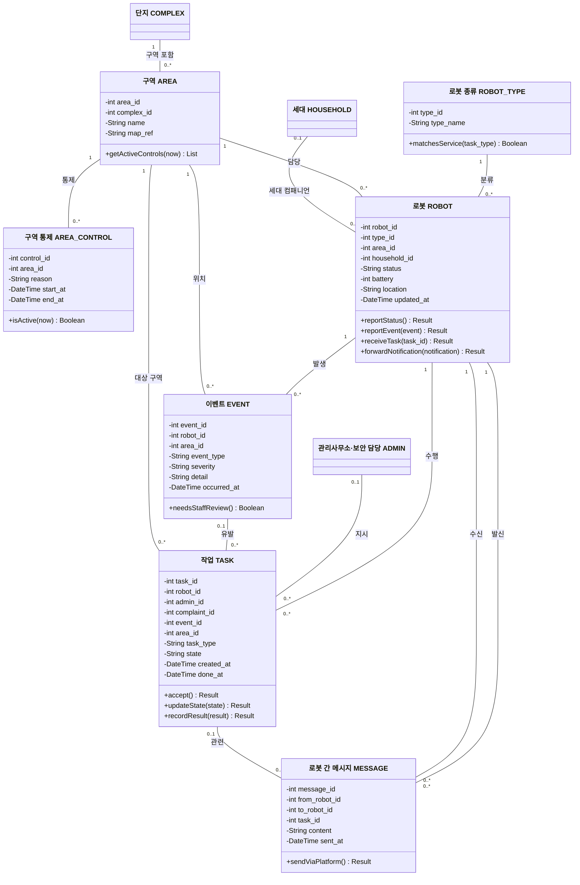
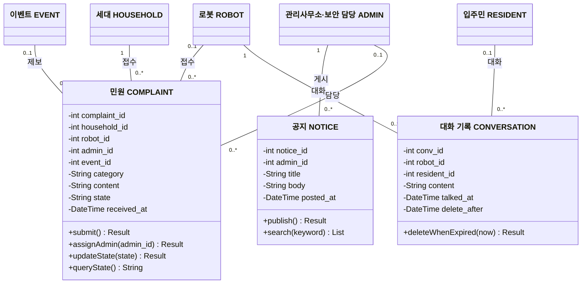
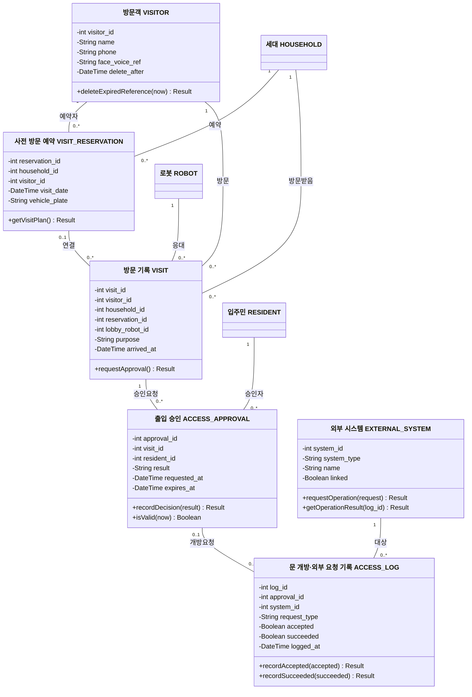
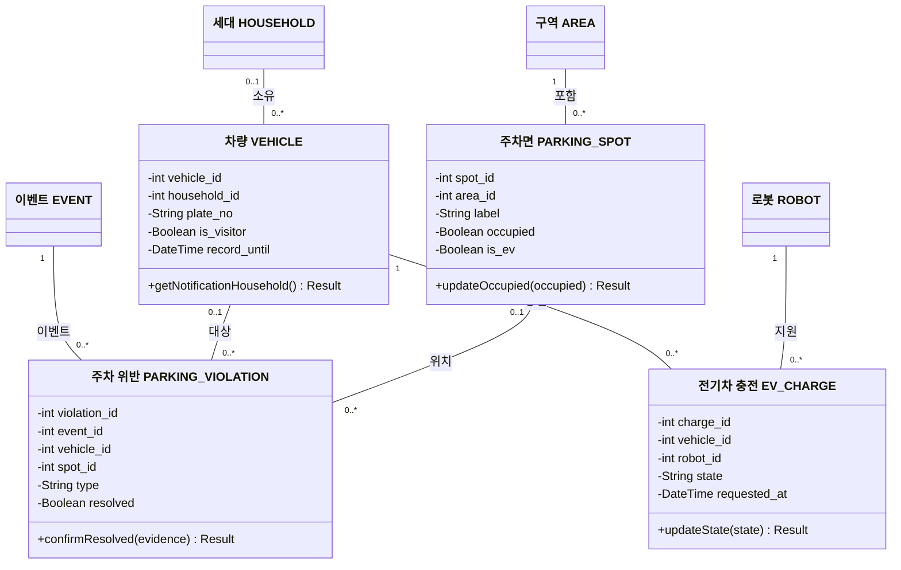
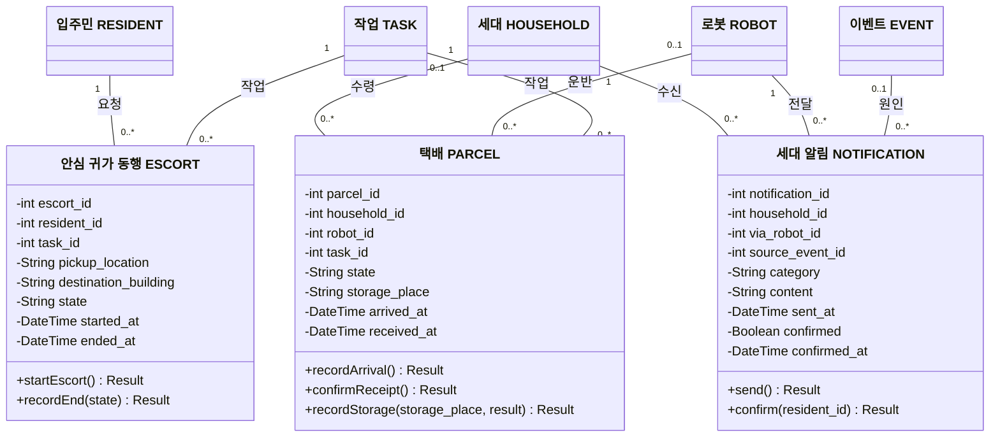

# CD — 아파트 로봇 정보 공유 플랫폼

버전: 용어 정합성 검토안 v3 · 2026-11-24

## 1. 작성 기준

이 CD는 구현 완료가 아닌 논리 설계안이다. **ERD에 있는 28개 엔티티의 이름·속성명·자료형·선택 관계를 유지**하고, 행동을 나타내는 메서드를 설계 제안으로 더했다. Platform만 ERD에 없는 조정 클래스다. PK/FK는 DB 제약이고 CD의 메서드는 객체의 행동이므로 두 문서가 같은 종류의 설계도는 아니다.

기존 세 갈래 구성(공통 구조 / 로봇·작업 / 서비스 정보)을 유지하되, 서비스 정보 부분을 네 장으로 나눴다. 따라서 **실제 그림은 6장**이다. SD의 개수에 맞춘 구성이 아니라 28개 클래스의 가독성을 위한 분할이다. 같은 이름의 클래스는 여러 그림에 나와도 동일한 클래스다.

### 핵심 변경

| 기존 CD | 이번 CD의 표기·구조 | 근거 |
| --- | --- | --- |
| User.role로 사람을 통합 | RESIDENT / ADMIN / VISITOR 분리 | ERD·용어표 |
| Robot 부모와 종류별 자식 클래스 | ROBOT + ROBOT_TYPE으로 종류 구분 | ERD 구조에 맞춘 CD 제안; 팀 확정 필요 |
| batteryLevel, taskId, status 등 | battery, task_id, TASK.state 등 정확한 속성명 | ERD |
| 방문과 승인·개방 결과를 Visit에 통합 | VISIT / ACCESS_APPROVAL / ACCESS_LOG 분리 | SD-03·ERD |
| 외부 설비 인터페이스 Facility | EXTERNAL_SYSTEM + ACCESS_LOG | ERD·용어표 |
| 차량 알림만 표현 | VEHICLE / PARKING_VIOLATION / NOTIFICATION 구분 | SD-05·ERD |
| 동행·택배를 일반 작업에 통합 | TASK + ESCORT / PARCEL | SD-02·06·ERD |
| 월패드 독립 클래스·접점 인터페이스 | 별도 엔티티·클래스를 추가하지 않고 연결 방식 미정 명시 | 용어표의 제안과 ERD 열린 질문 |

## CD-01. 단지·세대·사람과 플랫폼

관련 요구사항: FR-001, FR-010, NFR-003, NFR-007

입주민은 RESIDENT, 관리사무소·안전 담당자는 ADMIN으로 분리한다. ADMIN.role은 직원/안전담당이다. SRS의 시스템 관리자에 대응하는 계정·권한 구조는 ERD에 없으므로 별도 확인한다. Platform은 동작을 조정하는 설계 클래스이며 ERD 엔티티가 아니다.

Mermaid 원문

## CD-02. 로봇·구역·작업과 협업

관련 요구사항: FR-002~005, FR-009, NFR-002, NFR-005, NFR-008

ROBOT과 ROBOT_TYPE으로 종류를 구분한다. 이번 CD는 ERD와 맞추기 위해 종류별 자식 클래스를 만들지 않는 설계안을 택했다. 이는 팀의 상속 여부 결정을 대신 확정하는 것이 아니다. TASK.robot_id는 현재 ERD대로 필수이므로 작업은 대상 로봇을 정한 뒤 생성하는 모델이다. 미배정 요청은 별도 확인 사항이다. MESSAGE는 발신·수신 로봇을 연결하지만 전달·권한 검증은 Platform이 중계한다.

Mermaid 원문

## CD-03A. 민원·대화·공지

관련 요구사항: SD-01 / FR-006, FR-007, FR-101-1~5

COMPLAINT.robot_id/admin_id/event_id는 선택 연결이다. 직원이 직접 등록하거나 아직 담당자를 배정하지 않은 민원도 표현한다. HOUSEHOLD 연결은 필수이다. 로봇이 발견한 오염을 세대 연결 없이 민원으로 만들 수 있는지는 확정되지 않아 EVENT→TASK 흐름을 우선한다. CONVERSATION의 delete_after는 보관 기한이며 NOTICE는 ADMIN이 게시한다.

Mermaid 원문

## CD-03B. 방문·승인·외부 시스템

관련 요구사항: SD-03 / FR-103-1~5

VISIT(방문 사실), ACCESS_APPROVAL(승인 판단), ACCESS_LOG(실제 설비 요청 결과)를 분리했다. 엘리베이터 호출도 ACCESS_LOG.request_type으로 표현하며 ElevatorRequest를 추가하지 않는다. VISIT_RESERVATION은 ERD에 있지만 현재 SD-03에는 예약 흐름이 없다. ACCESS_APPROVAL.resident_id는 ERD대로 필수이며 미응답 시 값의 의미는 확인이 필요하다. 문 개방은 유효한 승인 검증 후에만 요청한다.

Mermaid 원문

## CD-03C. 주차·차량·충전

관련 요구사항: SD-05 / FR-105-1~5

PARKING_VIOLATION.vehicle_id/spot_id와 VEHICLE.household_id는 선택 연결이다. 미등록·오인식 의심 차량을 등록 차량으로 단정하지 않는다. NOTIFICATION.confirmed는 알림 확인이고 PARKING_VIOLATION.resolved는 실제 차량 이동 확인이므로 따로 관리한다. PARKING_SPOT·EV_CHARGE는 SRS에 요구되어 있으나 대응 SD가 아직 없다.

Mermaid 원문

## CD-03D. 동행·택배·세대 알림

관련 요구사항: SD-02, SD-06 / FR-008, FR-102-1~5, FR-106-1~6

ESCORT는 동행 업무 정보이고 TASK는 로봇 작업 정보다. PARCEL.robot_id/task_id는 선택 연결이므로 요청 직후의 미배정 택배를 표현할 수 있다. 반면 ESCORT.task_id는 필수라 미배정 동행 요청의 저장 방식은 확인이 필요하다. 택배 도착·수령·보관을 구분한다. NOTIFICATION은 현재 ERD의 source_event_id로 원인을 연결하며 TASK·VISIT 직접 FK를 임의로 추가하지 않는다. 세대 접점은 컴패니언으로 표시하고 월패드의 동일 취급은 미정으로 둔다.

Mermaid 원문

## 4. ERD 28개 엔티티와 CD의 대응

모든 엔티티를 같은 이름의 클래스로 반영했다. 아래의 메서드는 SRS·SD의 행동을 표현하는 제안이며 ERD에 함수가 있다는 의미는 아니다.

| ERD·CD 공통 이름 | 한국어 이름 | 상세 그림 | 책임 |
| --- | --- | --- | --- |
| COMPLEX | 단지 | CD-01 | getHouseholds |
| HOUSEHOLD | 세대 | CD-01 | getNotificationRobots |
| RESIDENT | 입주민 | CD-01 | requestService / confirmNotification |
| CONSENT | 개인정보 동의 | CD-01 | updateConsent |
| ADMIN | 관리사무소·보안 담당 | CD-01 | assignTask / updateComplaint |
| AREA | 구역 | CD-02 | getActiveControls |
| AREA_CONTROL | 구역 통제 | CD-02 | isActive |
| ROBOT_TYPE | 로봇 종류 | CD-02 | matchesService |
| ROBOT | 로봇 | CD-02 | reportStatus / reportEvent / receiveTask / forwardNotification |
| TASK | 작업 | CD-02 | accept / updateState / recordResult |
| EVENT | 이벤트 | CD-02 | needsStaffReview |
| MESSAGE | 로봇 간 메시지 | CD-02 | sendViaPlatform |
| COMPLAINT | 민원 | CD-03A | submit / assignAdmin / updateState / queryState |
| CONVERSATION | 대화 기록 | CD-03A | deleteWhenExpired |
| NOTICE | 공지 | CD-03A | publish / search |
| VISITOR | 방문객 | CD-03B | deleteExpiredReference |
| VISIT_RESERVATION | 사전 방문 예약 | CD-03B | getVisitPlan |
| VISIT | 방문 기록 | CD-03B | requestApproval |
| ACCESS_APPROVAL | 출입 승인 | CD-03B | recordDecision / isValid |
| EXTERNAL_SYSTEM | 외부 시스템 | CD-03B | requestOperation / getOperationResult |
| ACCESS_LOG | 문 개방·외부 요청 기록 | CD-03B | recordAccepted / recordSucceeded |
| VEHICLE | 차량 | CD-03C | getNotificationHousehold |
| PARKING_SPOT | 주차면 | CD-03C | updateOccupied |
| PARKING_VIOLATION | 주차 위반 | CD-03C | confirmResolved |
| EV_CHARGE | 전기차 충전 | CD-03C | updateState |
| ESCORT | 안심 귀가 동행 | CD-03D | startEscort / recordEnd |
| PARCEL | 택배 | CD-03D | recordArrival / confirmReceipt / recordStorage |
| NOTIFICATION | 세대 알림 | CD-03D | send / confirm |

## 5. 로봇 종류와 역할

공식 문구는 **공용 6종 + 세대 컴패니언**으로 통일한다. 로봇 한 대마다 별도 ROBOT.robot_id를 가지며, ROBOT_TYPE.type_id로 분류한다. 새 로봇 등록과 새 종류의 기능 구현은 별개의 일이다. type_name만 추가하면 모든 기능이 자동 구현되는 것은 아니다.

| ROBOT_TYPE.type_name | 문서 공통 명칭 | 주요 행동과 근거 |
| --- | --- | --- |
| 행정 | 관리사무소 행정 지원 로봇 | 민원 입력·조회, 공지 안내, 직원 연결 / FR-101 |
| 순찰 | 안심 귀가 및 순찰 로봇 | 귀가 동행·순찰, 위치·이상 보고 / FR-102 |
| 로비 | 현관·로비 안내 로봇 | 방문 안내·세대 호출·승인 요청 / FR-103 |
| 청소 | 바닥 청소 로봇 | 지정 공용 구역 청소·완료·오류 보고 / FR-104 |
| 주차 | 주차 관리 로봇 | 빈자리·등록 차량·위반 의심·충전 지원 / FR-105 |
| 택배 | 짐꾼·택배 운반 로봇 | 목적지 운반·도착·수령·부재 보관 / FR-106 |
| 컴패니언 | 세대 컴패니언 | 세대 알림과 입주민 응답 전달 / SD-03·05·06; SRS에 별도 기능 ID 보완 필요 |

상속 대신 종류 구분을 택해도 ERD의 종류별 업무 데이터(ESCORT, PARCEL, EV_CHARGE 등)는 유지한다. 세대 컴패니언은 household_id로 해당 세대에 연결하며 공용 로봇은 개인 사용자 소유로 묶지 않는다. 월패드를 ROBOT의 컴패니언 종류로 저장할지는 팀 확정 전이다.

## 6. 상태값 통일

| 대상·속성 | 값 |
| --- | --- |
| ROBOT.status | 대기 / 작업중 / 충전 / 오류 / 오프라인 |
| TASK.state | 요청 / 수락 / 진행 / 완료 / 중단 / 거절 |
| TASK.task_type | 청소 / 동행 / 배송 / 순찰 / 충전 |
| COMPLAINT.state | 접수 / 배정 / 처리중 / 완료 |
| PARCEL.state | 요청 / 운반중 / 도착 / 수령 / 부재 / 보관 / 실패 |
| ACCESS_APPROVAL.result | 승인 / 거절 / 미응답 / 검증실패 |
| ESCORT.state | 요청 / 배정 / 동행중 / 완료 / 이상 |
| EV_CHARGE.state | 요청 / 연결 / 충전중 / 완료 |
| EVENT.severity | 일반 / 위험 / 판단불가 |
| ADMIN.role | 직원 / 안전담당 |

ACCESS_LOG.accepted(요청 접수)와 succeeded(실제 성공), NOTIFICATION.confirmed(알림 확인)와 PARKING_VIOLATION.resolved(이동 확인), PARCEL.state의 도착·수령·보관을 서로 구분한다. 만료는 현재 ACCESS_APPROVAL.result의 값에 없으므로 expires_at으로 판정하고, 임의로 상태값을 추가하지 않는다.

## 7. 문서 간 차이와 팀 확인 사항

| 번호 | 확인한 차이·빈틈 | 이번 문서의 처리 | 팀에서 결정할 일 |
| --- | --- | --- | --- |
| O-01 | SRS는 공용 6종 중심, ERD는 컴패니언 포함 7개 type_name | 공용 6종 + 세대 컴패니언으로 표기 | 컴패니언 SRS ID·월패드 모델 |
| O-02 | SRS 작업 상태 예시는 대기·진행·완료·실패, ERD는 요청·수락·진행·완료·중단·거절 | CD는 ERD 후보 값 사용 | 실패의 구분·전환 규칙을 SRS와 통일 |
| O-03 | TASK.robot_id 필수, ESCORT.task_id 필수 / SD는 배정 전 요청 포함 | 현재 ERD의 필수 관계 유지 | 미배정 요청 저장·거절 기록 방식 |
| O-04 | ACCESS_APPROVAL.resident_id 필수 / result에 미응답 존재 | 승인 대상 입주민을 연결하는 의미인지 미확정 | 요청 대상과 실제 승인자 의미·nullable 여부 |
| O-05 | ACCESS_LOG.accepted/succeeded가 Boolean뿐임 | 응답 없는 결과를 성공으로 처리하지 않음 | 미확인·대기·타임아웃·실패 사유 저장 방법 |
| O-06 | NOTIFICATION.via_robot_id 필수, 전달 실패 상태 없음 | 기존 속성 유지 | 접점 없음·전달 실패·재시도 기록 방식 |
| O-07 | SRS 민원 데이터에 사용자 ID, ERD에는 household_id만 있음 | RESIDENT 직접 FK를 추가하지 않음 | 본인 민원 조회 범위(개인/세대)·제출자 식별 |
| O-08 | SRS 알림에 사용자 ID, ERD는 household_id 중심 | 세대 수신 모델 유지 | 개인별 확인자·다중 입주민 확인 정책 |
| O-09 | SRS 시스템 관리자 역할, ERD ADMIN.role은 직원/안전담당 | 별도 역할값을 확정하지 않음 | 계정·인증·시스템 관리 권한 모델 |
| O-10 | SRS 작업 시작 시각·결과 이력, ERD TASK는 created_at/done_at만 있음 | recordResult 메서드는 행동 제안 | 결과·중단 사유·시작 시각·상태 이력 저장 위치 |
| O-11 | COMPLAINT에 완료 시각·처리 결과 필드 없음 | 처리 시간 KPI는 측정 준비 미완료로 표시 | 배정·완료 시각·결과 저장 항목 |
| O-12 | SRS 통신 장애 시 플랫폼 보고, 실제 단절 중 즉시 전송 불가 | 로컬 보존·복구 후 보고는 제안 | 오프라인 판정·재전송·안전 동작 |
| O-13 | 방문 예약·빈자리·충전은 ERD 또는 SRS에 있으나 SD에 없음 | 클래스 유지, 흐름 미완료 표시 | 추가 SD와 수락 기준 |
| O-14 | EXTERNAL_SYSTEM.linked는 가능 여부만 표현 | 실제 출입·엘리베이터·충전기 연동 미검증 | 제품 인터페이스·허가·실패 대응 검증 |
| O-15 | BRD는 민원 시간 단축 등 정량 목표 미정 | PRD에 지표 정의만 제안 | 목표 수치·기준선·측정 기간 |

## 8. 객체 생성 예시

| 예시 객체 | 클래스·종류 | 연결 |
| --- | --- | --- |
| robot_id=101 | ROBOT / type_name=컴패니언 | household_id=1001 |
| robot_id=102 | ROBOT / type_name=컴패니언 | household_id=1001; 101과 별도 객체 |
| robot_id=201 | ROBOT / type_name=청소 | 담당 AREA에 연결, 공용 작업 수행 |
| robot_id=202 | ROBOT / type_name=청소 | 201과 다른 상태·배터리·작업 이력 |

숫자는 설명용 가상 값이다. 같은 종류의 로봇을 여러 대 등록해도 각각 고유 robot_id로 구분한다.

## 9. 발표용 설명

“저희 CD는 팀 ERD의 28개 엔티티와 이름을 맞추고 각 객체의 행동을 추가했습니다. 로봇은 공통 ROBOT과 ROBOT_TYPE으로 구분하며 플랫폼이 작업과 메시지를 중계합니다. 민원, 동행, 방문 승인, 외부 시스템 결과, 주차, 택배와 세대 알림을 별도 클래스로 관리합니다. 특히 출입 승인과 실제 개방 성공, 알림 확인과 차량 이동, 택배 도착과 수령을 구분했습니다. 그림은 가독성을 위해 여섯 장으로 나눴고, 실제 설비 연동과 미확정 데이터 항목은 팀 확인 사항으로 남겼습니다.”
