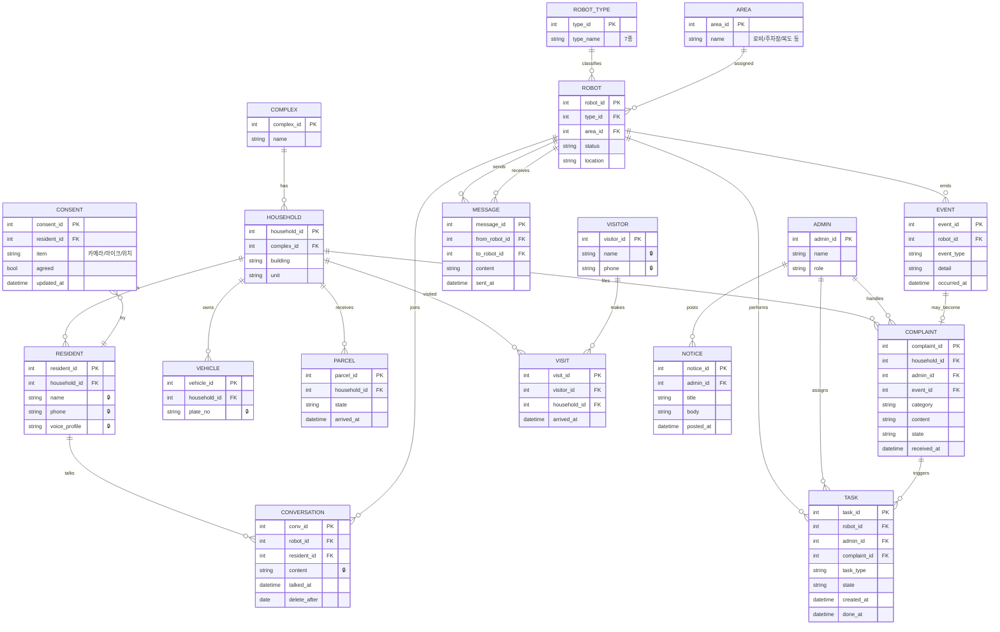

# ERD 초안 - 아파트 로봇 정보 공유 플랫폼

> 기준: 로봇 7종 md의 "플랫폼에서 받는 것 / 주는 것". 초안이며 CD 클래스명과 맞춰 수정한다.
> 🔒 = 개인정보·민감정보 컬럼

## 설계 메모
- 로봇 7종은 ROBOT 하나에 ROBOT_TYPE으로 구분한다(공통 구조).
- 로봇 간 협업은 MESSAGE, 센서/이상 감지는 EVENT, 관리사무소 지시는 TASK에 저장한다.
- 이벤트가 민원이 될 수 있어 EVENT → COMPLAINT → TASK로 이어진다.
- CONVERSATION의 delete_after로 보관·삭제 정책을 반영한다.
- CONSENT로 카메라·마이크·위치 동의를 관리한다.

## 점검 체크리스트
- [ ] 로봇 md 7개의 "받는 것/주는 것"이 모두 엔티티·컬럼에 있는가
- [ ] CD 클래스명과 엔티티명이 같은가
- [ ] 🔒 컬럼에 접근 권한 정책이 SRS에 있는가
