# ERD 초안 - 아파트 로봇 정보 공유 플랫폼

> 기준: robot.md(로봇 6종 정의서) + SD.md(SD-01~06) + 앞서 만든 ERD 초안. 엔티티 이름은 CD와 아직 맞추지 않았다(추후 조정).
> 컬럼 설명의 `개인정보`는 접근 권한·보관/삭제 정책 대상이다.

## 1. 범위와 가정
- robot.md에는 로봇 6종이 있고, 세대 안 컴패니언 로봇은 ROBOT_TYPE의 한 종류로 넣었다(SD의 '세대 컴패니언·월패드').
- 로봇 수 표기: 공용 6종 + 세대 컴패니언 1종(ROBOT_TYPE 값 7개). 발표에서 "7개"로 셀지 "6개 + 컴패니언"으로 셀지는 팀에서 아직 정하지 않았다(문서에서는 "6종 + 컴패니언"으로 통일).
- ROBOT은 공통 테이블, 종류별 전용 데이터는 별도 테이블(ESCORT, PARCEL, PARKING_SPOT, EV_CHARGE 등)로 분리했다.
- 이번 초안에서 새로 추가한 엔티티: ACCESS_APPROVAL, ACCESS_LOG, EXTERNAL_SYSTEM, NOTIFICATION, ESCORT, VISIT_RESERVATION, AREA_CONTROL, PARKING_SPOT, PARKING_VIOLATION, EV_CHARGE.
- 로봇 내부 센서·모터 정보는 넣지 않았다. 위치·배터리·상태만 플랫폼에 보고되는 값으로 둔다.
- v2.1 보정: nullable FK(값이 없을 수 있는 FK)는 mermaid 관계선도 "0 또는 1" 표기(`|o--o{`)로 맞췄고, COMPLAINT.robot_id·admin_id를 nullable로 바꿨다(접수 직후엔 담당자가 없고, 직원이 직접 입력한 민원은 접수 로봇이 없을 수 있음).
- ERD.png는 아래 5개 묶음으로 그린다: 단지·세대·사람 / 방문·출입 / 로봇·작업 / 행정·대화 / 주차·택배. 새로 추가한 엔티티 10개는 주황색.

## 2. ERD

```mermaid
erDiagram
    COMPLEX ||--o{ HOUSEHOLD : "단지 보유"
    COMPLEX ||--o{ AREA : "구역 포함"
    HOUSEHOLD ||--o{ RESIDENT : "거주"
    RESIDENT ||--o{ CONSENT : "동의"
    HOUSEHOLD ||--o{ VISIT_RESERVATION : "예약"
    VISITOR ||--o{ VISIT_RESERVATION : "예약자"
    VISITOR ||--o{ VISIT : "방문"
    HOUSEHOLD ||--o{ VISIT : "방문받음"
    VISIT_RESERVATION |o--o{ VISIT : "연결"
    ROBOT ||--o{ VISIT : "응대"
    VISIT ||--o{ ACCESS_APPROVAL : "승인요청"
    RESIDENT ||--o{ ACCESS_APPROVAL : "승인자"
    ACCESS_APPROVAL |o--o{ ACCESS_LOG : "개방요청"
    EXTERNAL_SYSTEM ||--o{ ACCESS_LOG : "대상"
    ROBOT_TYPE ||--o{ ROBOT : "분류"
    AREA ||--o{ ROBOT : "담당"
    HOUSEHOLD |o--o{ ROBOT : "세대 컴패니언"
    AREA ||--o{ AREA_CONTROL : "통제"
    ROBOT ||--o{ TASK : "수행"
    ADMIN |o--o{ TASK : "지시"
    COMPLAINT |o--o{ TASK : "유발"
    EVENT |o--o{ TASK : "유발"
    AREA ||--o{ TASK : "대상 구역"
    ROBOT ||--o{ EVENT : "발생"
    AREA ||--o{ EVENT : "위치"
    ROBOT ||--o{ MESSAGE : "발신"
    ROBOT ||--o{ MESSAGE : "수신"
    TASK |o--o{ MESSAGE : "관련"
    HOUSEHOLD ||--o{ NOTIFICATION : "수신"
    ROBOT ||--o{ NOTIFICATION : "전달"
    EVENT |o--o{ NOTIFICATION : "원인"
    ROBOT ||--o{ CONVERSATION : "대화"
    RESIDENT |o--o{ CONVERSATION : "대화"
    HOUSEHOLD ||--o{ COMPLAINT : "접수"
    ROBOT |o--o{ COMPLAINT : "접수"
    ADMIN |o--o{ COMPLAINT : "담당"
    EVENT |o--o{ COMPLAINT : "제보"
    ADMIN ||--o{ NOTICE : "게시"
    RESIDENT ||--o{ ESCORT : "요청"
    TASK ||--o{ ESCORT : "작업"
    HOUSEHOLD |o--o{ VEHICLE : "소유"
    AREA ||--o{ PARKING_SPOT : "포함"
    EVENT ||--o{ PARKING_VIOLATION : "이벤트"
    VEHICLE |o--o{ PARKING_VIOLATION : "대상"
    PARKING_SPOT |o--o{ PARKING_VIOLATION : "위치"
    VEHICLE ||--o{ EV_CHARGE : "충전"
    ROBOT ||--o{ EV_CHARGE : "지원"
    HOUSEHOLD ||--o{ PARCEL : "수령"
    ROBOT |o--o{ PARCEL : "운반"
    TASK |o--o{ PARCEL : "작업"
    COMPLEX {
        int complex_id PK
        string name
    }
    HOUSEHOLD {
        int household_id PK
        int complex_id FK
        string building "동"
        string unit "호수"
        bool callable "호출 가능 여부"
        bool absent "부재 여부"
        string receive_pref "희망 수령 방식"
    }
    RESIDENT {
        int resident_id PK
        int household_id FK
        string name "개인정보"
        string phone "개인정보"
        string voice_profile "개인정보"
        bool can_approve "출입 승인권"
    }
    CONSENT {
        int consent_id PK
        int resident_id FK
        string item "카메라/마이크/위치"
        bool agreed
        datetime updated_at
    }
    VISITOR {
        int visitor_id PK
        string name "개인정보"
        string phone "개인정보"
        string face_voice_ref "개인정보 목적 달성 후 삭제"
        datetime delete_after
    }
    VISIT_RESERVATION {
        int reservation_id PK
        int household_id FK
        int visitor_id FK
        datetime visit_date
        string vehicle_plate "개인정보"
    }
    VISIT {
        int visit_id PK
        int visitor_id FK
        int household_id FK
        int reservation_id FK "nullable"
        int lobby_robot_id FK
        string purpose
        datetime arrived_at
    }
    ACCESS_APPROVAL {
        int approval_id PK
        int visit_id FK
        int resident_id FK "승인자"
        string result "승인/거절/미응답/검증실패"
        datetime requested_at
        datetime expires_at "유효 시간"
    }
    EXTERNAL_SYSTEM {
        int system_id PK
        string system_type "출입문/엘리베이터/충전기"
        string name
        bool linked "연동 가능 여부"
    }
    ACCESS_LOG {
        int log_id PK
        int approval_id FK "nullable"
        int system_id FK
        string request_type "문 개방/엘리베이터 호출"
        bool accepted "요청 접수"
        bool succeeded "실제 성공"
        datetime logged_at
    }
    ROBOT_TYPE {
        int type_id PK
        string type_name "컴패니언/행정/순찰/로비/청소/주차/택배"
    }
    AREA {
        int area_id PK
        int complex_id FK
        string name "로비/복도/주차장 등"
        string map_ref "지도 정보"
    }
    AREA_CONTROL {
        int control_id PK
        int area_id FK
        string reason "공사/행사"
        datetime start_at
        datetime end_at
    }
    ROBOT {
        int robot_id PK
        int type_id FK
        int area_id FK "담당 구역"
        int household_id FK "컴패니언만 nullable"
        string status "대기/작업중/충전/오류/오프라인"
        int battery
        string location
        datetime updated_at
    }
    ADMIN {
        int admin_id PK
        string name
        string role "직원/안전담당"
    }
    TASK {
        int task_id PK
        int robot_id FK
        int admin_id FK "nullable"
        int complaint_id FK "nullable"
        int event_id FK "nullable"
        int area_id FK
        string task_type "청소/동행/배송/순찰/충전"
        string state "요청/수락/진행/완료/중단/거절"
        datetime created_at
        datetime done_at
    }
    EVENT {
        int event_id PK
        int robot_id FK
        int area_id FK
        string event_type "이상감지/오류/위반/도착 등"
        string severity "일반/위험/판단불가"
        string detail
        datetime occurred_at
    }
    MESSAGE {
        int message_id PK
        int from_robot_id FK
        int to_robot_id FK
        int task_id FK "nullable"
        string content
        datetime sent_at
    }
    NOTIFICATION {
        int notification_id PK
        int household_id FK
        int via_robot_id FK "컴패니언/월패드"
        int source_event_id FK "nullable"
        string category "방문객/차량/택배/안전"
        string content
        datetime sent_at
        bool confirmed "알림 확인"
        datetime confirmed_at
    }
    CONVERSATION {
        int conv_id PK
        int robot_id FK
        int resident_id FK "nullable"
        string content "개인정보"
        datetime talked_at
        datetime delete_after "보관 기한"
    }
    COMPLAINT {
        int complaint_id PK
        int household_id FK
        int robot_id FK "접수 로봇 nullable"
        int admin_id FK "담당 nullable"
        int event_id FK "nullable 제보"
        string category
        string content
        string state "접수/배정/처리중/완료"
        datetime received_at
    }
    NOTICE {
        int notice_id PK
        int admin_id FK
        string title
        string body
        datetime posted_at
    }
    ESCORT {
        int escort_id PK
        int resident_id FK
        int task_id FK
        string pickup_location "개인정보 위치"
        string destination_building
        string state "요청/배정/동행중/완료/이상"
        datetime started_at
        datetime ended_at
    }
    VEHICLE {
        int vehicle_id PK
        int household_id FK "방문 차량은 nullable"
        string plate_no "개인정보"
        bool is_visitor
        datetime record_until "방문 차량 보관 기한"
    }
    PARKING_SPOT {
        int spot_id PK
        int area_id FK
        string label
        bool occupied
        bool is_ev "전기차 충전 구역"
    }
    PARKING_VIOLATION {
        int violation_id PK
        int event_id FK
        int vehicle_id FK "nullable 오인식 가능"
        int spot_id FK "nullable"
        string type "이중주차 등"
        bool resolved "차량 이동 확인"
    }
    EV_CHARGE {
        int charge_id PK
        int vehicle_id FK
        int robot_id FK
        string state "요청/연결/충전중/완료"
        datetime requested_at
    }
    PARCEL {
        int parcel_id PK
        int household_id FK
        int robot_id FK "nullable"
        int task_id FK "nullable"
        string state "요청/운반중/도착/수령/부재/보관/실패"
        string storage_place
        datetime arrived_at
        datetime received_at
    }
```

## 3. 엔티티 정의서

### COMPLEX (단지)
| 컬럼 | 타입 | 키 | 설명 |
|---|---|---|---|
| complex_id | int | PK |  |
| name | string |  |  |

### HOUSEHOLD (세대)
| 컬럼 | 타입 | 키 | 설명 |
|---|---|---|---|
| household_id | int | PK |  |
| complex_id | int | FK |  |
| building | string |  | 동 |
| unit | string |  | 호수 |
| callable | bool |  | 호출 가능 여부 |
| absent | bool |  | 부재 여부 |
| receive_pref | string |  | 희망 수령 방식 |

### RESIDENT (입주민)
| 컬럼 | 타입 | 키 | 설명 |
|---|---|---|---|
| resident_id | int | PK |  |
| household_id | int | FK |  |
| name | string |  | 개인정보 |
| phone | string |  | 개인정보 |
| voice_profile | string |  | 개인정보 |
| can_approve | bool |  | 출입 승인권 |

### CONSENT (개인정보 동의)
| 컬럼 | 타입 | 키 | 설명 |
|---|---|---|---|
| consent_id | int | PK |  |
| resident_id | int | FK |  |
| item | string |  | 카메라/마이크/위치 |
| agreed | bool |  |  |
| updated_at | datetime |  |  |

### VISITOR (방문객)
| 컬럼 | 타입 | 키 | 설명 |
|---|---|---|---|
| visitor_id | int | PK |  |
| name | string |  | 개인정보 |
| phone | string |  | 개인정보 |
| face_voice_ref | string |  | 개인정보 목적 달성 후 삭제 |
| delete_after | datetime |  |  |

### VISIT_RESERVATION (사전 방문 예약)
| 컬럼 | 타입 | 키 | 설명 |
|---|---|---|---|
| reservation_id | int | PK |  |
| household_id | int | FK |  |
| visitor_id | int | FK |  |
| visit_date | datetime |  |  |
| vehicle_plate | string |  | 개인정보 |

### VISIT (방문 기록)
| 컬럼 | 타입 | 키 | 설명 |
|---|---|---|---|
| visit_id | int | PK |  |
| visitor_id | int | FK |  |
| household_id | int | FK |  |
| reservation_id | int | FK | nullable |
| lobby_robot_id | int | FK |  |
| purpose | string |  |  |
| arrived_at | datetime |  |  |

### ACCESS_APPROVAL (출입 승인)
| 컬럼 | 타입 | 키 | 설명 |
|---|---|---|---|
| approval_id | int | PK |  |
| visit_id | int | FK |  |
| resident_id | int | FK | 승인자 |
| result | string |  | 승인/거절/미응답/검증실패 |
| requested_at | datetime |  |  |
| expires_at | datetime |  | 유효 시간 |

### EXTERNAL_SYSTEM (외부 시스템)
| 컬럼 | 타입 | 키 | 설명 |
|---|---|---|---|
| system_id | int | PK |  |
| system_type | string |  | 출입문/엘리베이터/충전기 |
| name | string |  |  |
| linked | bool |  | 연동 가능 여부 |

### ACCESS_LOG (문 개방·외부 요청 기록)
| 컬럼 | 타입 | 키 | 설명 |
|---|---|---|---|
| log_id | int | PK |  |
| approval_id | int | FK | nullable |
| system_id | int | FK |  |
| request_type | string |  | 문 개방/엘리베이터 호출 |
| accepted | bool |  | 요청 접수 |
| succeeded | bool |  | 실제 성공 |
| logged_at | datetime |  |  |

### ROBOT_TYPE (로봇 종류)
| 컬럼 | 타입 | 키 | 설명 |
|---|---|---|---|
| type_id | int | PK |  |
| type_name | string |  | 컴패니언/행정/순찰/로비/청소/주차/택배 |

### AREA (구역)
| 컬럼 | 타입 | 키 | 설명 |
|---|---|---|---|
| area_id | int | PK |  |
| complex_id | int | FK |  |
| name | string |  | 로비/복도/주차장 등 |
| map_ref | string |  | 지도 정보 |

### AREA_CONTROL (구역 통제)
| 컬럼 | 타입 | 키 | 설명 |
|---|---|---|---|
| control_id | int | PK |  |
| area_id | int | FK |  |
| reason | string |  | 공사/행사 |
| start_at | datetime |  |  |
| end_at | datetime |  |  |

### ROBOT (로봇)
| 컬럼 | 타입 | 키 | 설명 |
|---|---|---|---|
| robot_id | int | PK |  |
| type_id | int | FK |  |
| area_id | int | FK | 담당 구역 |
| household_id | int | FK | 컴패니언만 nullable |
| status | string |  | 대기/작업중/충전/오류/오프라인 |
| battery | int |  |  |
| location | string |  |  |
| updated_at | datetime |  |  |

### ADMIN (관리사무소·보안 담당)
| 컬럼 | 타입 | 키 | 설명 |
|---|---|---|---|
| admin_id | int | PK |  |
| name | string |  |  |
| role | string |  | 직원/안전담당 |

### TASK (작업)
| 컬럼 | 타입 | 키 | 설명 |
|---|---|---|---|
| task_id | int | PK |  |
| robot_id | int | FK |  |
| admin_id | int | FK | nullable |
| complaint_id | int | FK | nullable |
| event_id | int | FK | nullable |
| area_id | int | FK |  |
| task_type | string |  | 청소/동행/배송/순찰/충전 |
| state | string |  | 요청/수락/진행/완료/중단/거절 |
| created_at | datetime |  |  |
| done_at | datetime |  |  |

### EVENT (이벤트)
| 컬럼 | 타입 | 키 | 설명 |
|---|---|---|---|
| event_id | int | PK |  |
| robot_id | int | FK |  |
| area_id | int | FK |  |
| event_type | string |  | 이상감지/오류/위반/도착 등 |
| severity | string |  | 일반/위험/판단불가 |
| detail | string |  |  |
| occurred_at | datetime |  |  |

### MESSAGE (로봇 간 메시지)
| 컬럼 | 타입 | 키 | 설명 |
|---|---|---|---|
| message_id | int | PK |  |
| from_robot_id | int | FK |  |
| to_robot_id | int | FK |  |
| task_id | int | FK | nullable |
| content | string |  |  |
| sent_at | datetime |  |  |

### NOTIFICATION (세대 알림)
| 컬럼 | 타입 | 키 | 설명 |
|---|---|---|---|
| notification_id | int | PK |  |
| household_id | int | FK |  |
| via_robot_id | int | FK | 컴패니언/월패드 |
| source_event_id | int | FK | nullable |
| category | string |  | 방문객/차량/택배/안전 |
| content | string |  |  |
| sent_at | datetime |  |  |
| confirmed | bool |  | 알림 확인 |
| confirmed_at | datetime |  |  |

### CONVERSATION (대화 기록)
| 컬럼 | 타입 | 키 | 설명 |
|---|---|---|---|
| conv_id | int | PK |  |
| robot_id | int | FK |  |
| resident_id | int | FK | nullable |
| content | string |  | 개인정보 |
| talked_at | datetime |  |  |
| delete_after | datetime |  | 보관 기한 |

### COMPLAINT (민원)
| 컬럼 | 타입 | 키 | 설명 |
|---|---|---|---|
| complaint_id | int | PK |  |
| household_id | int | FK |  |
| robot_id | int | FK | nullable 접수 로봇(직원이 직접 입력한 민원이면 비움) |
| admin_id | int | FK | nullable 담당(접수 직후엔 미배정) |
| event_id | int | FK | nullable 제보 |
| category | string |  |  |
| content | string |  |  |
| state | string |  | 접수/배정/처리중/완료 |
| received_at | datetime |  |  |

### NOTICE (공지)
| 컬럼 | 타입 | 키 | 설명 |
|---|---|---|---|
| notice_id | int | PK |  |
| admin_id | int | FK |  |
| title | string |  |  |
| body | string |  |  |
| posted_at | datetime |  |  |

### ESCORT (안심 귀가 동행)
| 컬럼 | 타입 | 키 | 설명 |
|---|---|---|---|
| escort_id | int | PK |  |
| resident_id | int | FK |  |
| task_id | int | FK |  |
| pickup_location | string |  | 개인정보 위치 |
| destination_building | string |  |  |
| state | string |  | 요청/배정/동행중/완료/이상 |
| started_at | datetime |  |  |
| ended_at | datetime |  |  |

### VEHICLE (차량)
| 컬럼 | 타입 | 키 | 설명 |
|---|---|---|---|
| vehicle_id | int | PK |  |
| household_id | int | FK | 방문 차량은 nullable |
| plate_no | string |  | 개인정보 |
| is_visitor | bool |  |  |
| record_until | datetime |  | 방문 차량 보관 기한 |

### PARKING_SPOT (주차면)
| 컬럼 | 타입 | 키 | 설명 |
|---|---|---|---|
| spot_id | int | PK |  |
| area_id | int | FK |  |
| label | string |  |  |
| occupied | bool |  |  |
| is_ev | bool |  | 전기차 충전 구역 |

### PARKING_VIOLATION (주차 위반)
| 컬럼 | 타입 | 키 | 설명 |
|---|---|---|---|
| violation_id | int | PK |  |
| event_id | int | FK |  |
| vehicle_id | int | FK | nullable 오인식 가능 |
| spot_id | int | FK | nullable |
| type | string |  | 이중주차 등 |
| resolved | bool |  | 차량 이동 확인 |

### EV_CHARGE (전기차 충전)
| 컬럼 | 타입 | 키 | 설명 |
|---|---|---|---|
| charge_id | int | PK |  |
| vehicle_id | int | FK |  |
| robot_id | int | FK |  |
| state | string |  | 요청/연결/충전중/완료 |
| requested_at | datetime |  |  |

### PARCEL (택배)
| 컬럼 | 타입 | 키 | 설명 |
|---|---|---|---|
| parcel_id | int | PK |  |
| household_id | int | FK |  |
| robot_id | int | FK | nullable |
| task_id | int | FK | nullable |
| state | string |  | 요청/운반중/도착/수령/부재/보관/실패 |
| storage_place | string |  |  |
| arrived_at | datetime |  |  |
| received_at | datetime |  |  |

## 4. 요구 ↔ 엔티티 대응 (robot.md · SD 기준)
| 출처 | 플랫폼 입·출력 | 엔티티 |
|---|---|---|
| 행정 지원 | 민원 접수, 처리 상태, 직원 연결, 타 로봇 제보 | COMPLAINT, EVENT, TASK, CONVERSATION, NOTICE |
| 순찰·귀가 | 귀가 호출, 동행 완료, 이상 감지 이벤트, 위치·상태 | ESCORT, TASK, EVENT, ROBOT |
| 현관·로비 | 방문객 도착, 승인/거절 결과, 사전 예약, 최소화 얼굴·음성 | VISIT, VISITOR, VISIT_RESERVATION, ACCESS_APPROVAL, ACCESS_LOG |
| 청소 | 구역 지도, 작업 일정, 구역 통제, 완료 기록, 오류 | AREA, AREA_CONTROL, TASK, EVENT |
| 주차 | 등록 차량·세대 매핑, 주차면 상태, 위반 이벤트, 충전 | VEHICLE, PARKING_SPOT, PARKING_VIOLATION, EV_CHARGE |
| 택배 | 배송 요청, 엘리베이터 허가, 부재 여부, 수령 실패 | PARCEL, TASK, ACCESS_LOG, HOUSEHOLD(absent) |
| SD 공통 | 세대 알림, 알림 확인 ≠ 조치 완료 | NOTIFICATION(confirmed), PARKING_VIOLATION(resolved) |

## 5. 개인정보 컬럼과 보관 정책 메모
| 컬럼 | 정책 후보 |
|---|---|
| RESIDENT.name/phone/voice_profile | 동의 기반 수집, 접근 권한 제한 |
| VISITOR.face_voice_ref | 방문 목적 달성 즉시 삭제(delete_after) |
| CONVERSATION.content | 보관 기한(delete_after) 후 삭제 |
| VEHICLE.plate_no | 해당 세대·관리자만 열람, 방문 차량은 record_until 이후 삭제 |
| ESCORT.pickup_location | 동행 종료 후 최소 기간만 보관 |
| PARCEL | 내용물 정보는 수집하지 않음 |

## 6. 열린 질문 (팀 확인 필요)
- 로봇을 Robot 부모/자식 클래스로 할지, ROBOT.type으로 할지(CD와 일치 필요).
- 본인 확인 방식(민원 접수), 호출 수단, 동행 종료 지점은 SD에서도 미정.
- 엘리베이터 연동이 불가능하면 EXTERNAL_SYSTEM·ACCESS_LOG를 EVENT로 단순화.
- 방문객 얼굴·음성은 원본 저장 대신 참조값/삭제 시각만 둘지.
- 월패드를 컴패니언과 같은 접점(ROBOT type=컴패니언)으로 볼지, 별도 엔티티로 둘지(SD에서는 "세대 컴패니언·월패드" 하나의 접점).
- 민원 처리 시간을 재려면 COMPLAINT에 배정·완료 시각 컬럼이 필요하다(현재는 received_at만 있음). BRD 기대효과의 측정 지표를 정할 때 같이 결정.
- SD에는 아직 없지만 robot.md에는 있는 흐름(사전 방문 예약, 빈자리 안내, 전기차 충전)을 ERD가 먼저 담고 있다. SD 반영 여부는 권주용 확인 필요.
## 7. 관련 파일
- ERD.png: 28개 엔티티 전체 그림(5개 묶음, 신규 10개 주황색)
- ERD_요약.png: 발표용 요약 ERD(핵심 엔티티만)
- ERD_엘리베이터불가_대안.md: 엘리베이터·출입 시스템 연동이 불가능할 때의 단순화 안(제안, 팀 미확정)
- 팀_용어_맞추기표.md: SD·ERD·CD 이름 대응표
