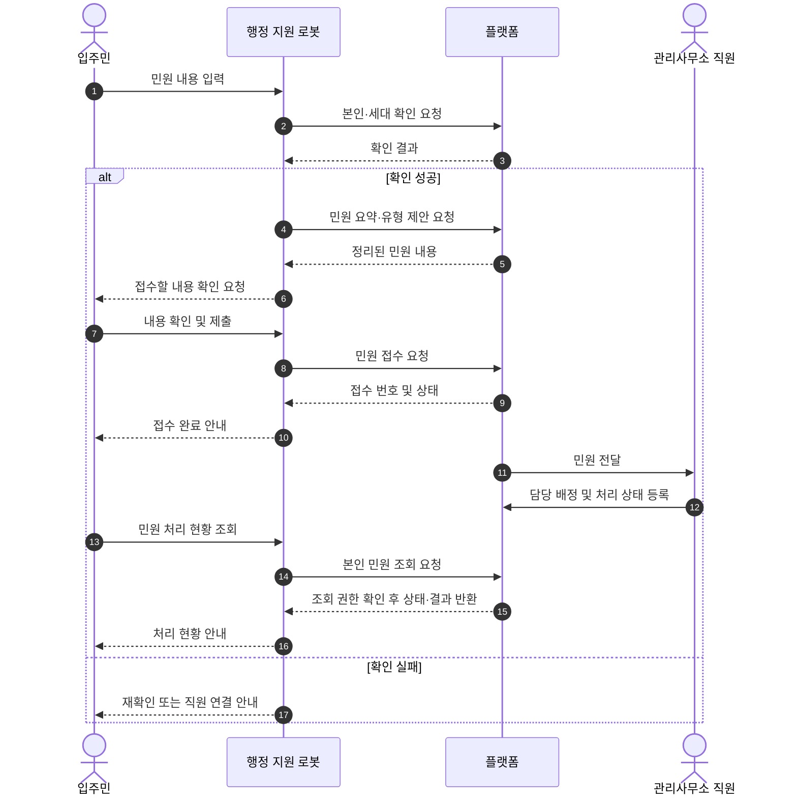
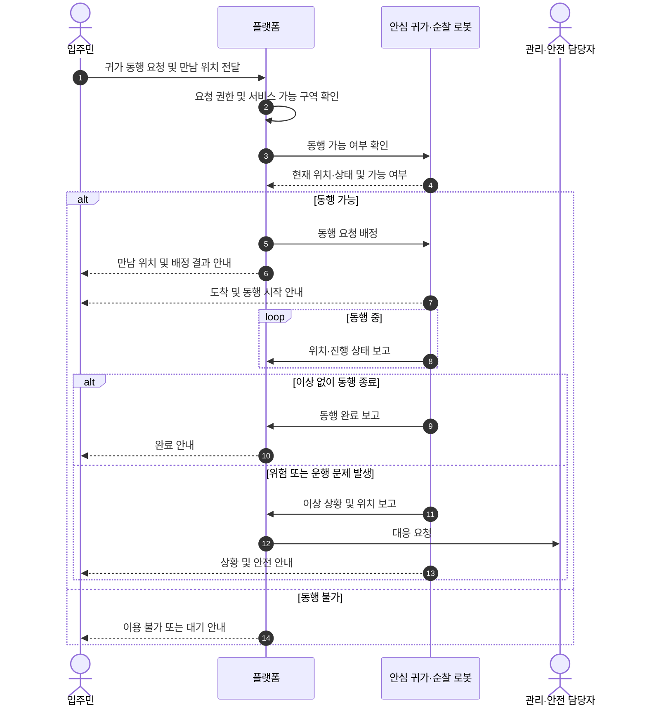
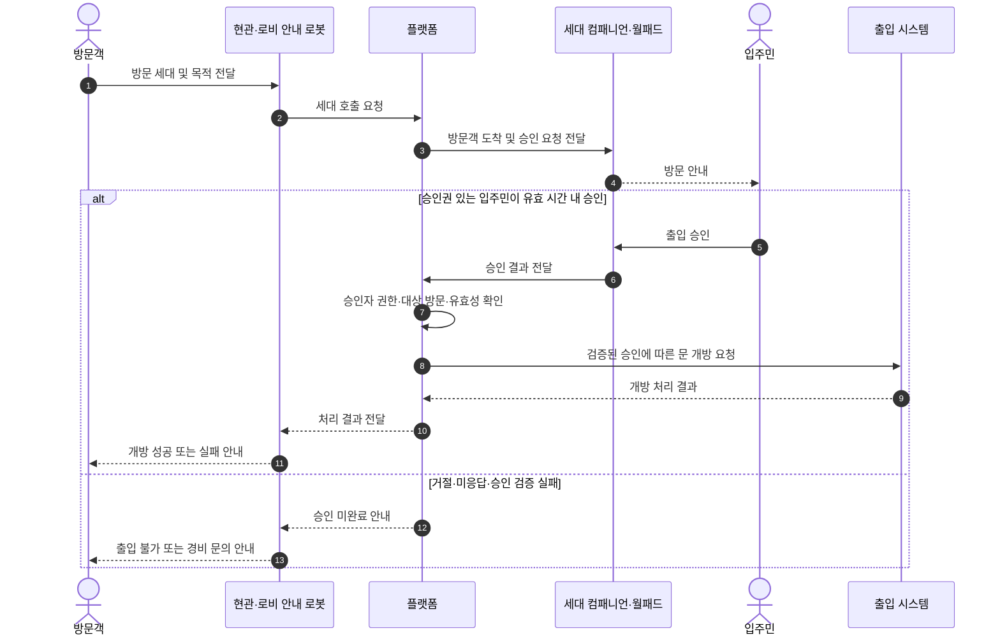
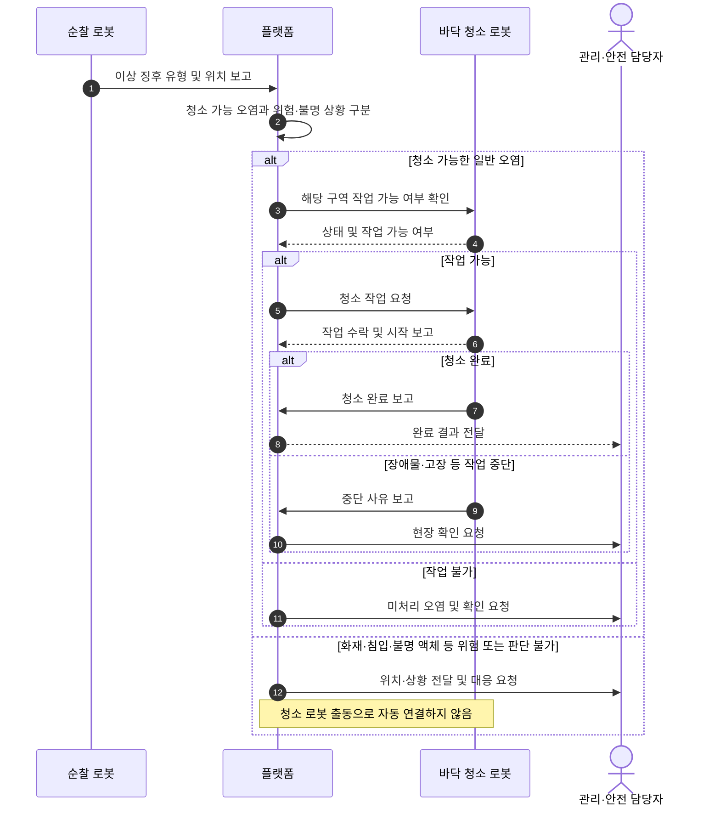
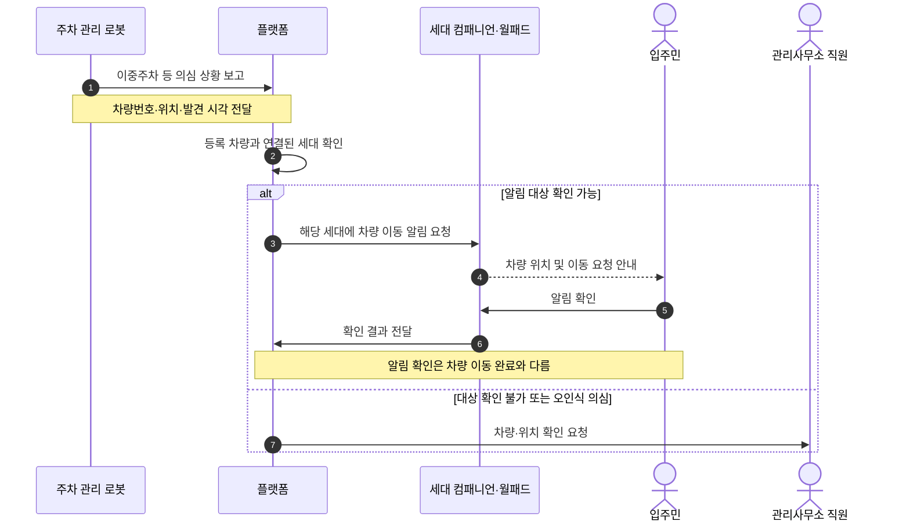
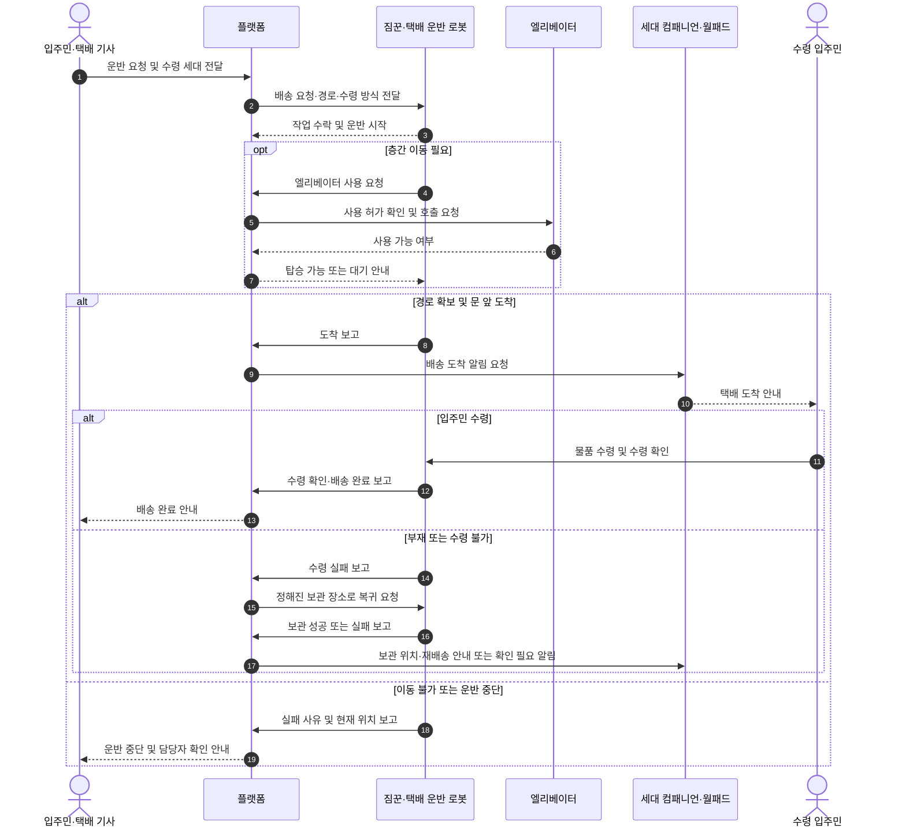

# SD — Sequence Diagram

## AI Companion Robot in Apartment

팀이 제안한 로봇의 역할을 바탕으로 주요 서비스의 메시지 전달 순서를 정리한 초기 시퀀스 다이어그램입니다. 내부 서버·DB·API 구조는 정하지 않고 **사용자, 로봇, 플랫폼, 관리사무소 및 외부 설비**의 상호작용에 집중합니다.

- 실선 화살표는 요청·전달, 점선 화살표는 응답·결과를 나타냅니다.
- `alt / else`는 조건에 따른 분기입니다.
- 거실 컴패니언 로봇·월패드는 세대 알림 접점이며, 실제 구현·연동 방식은 미정입니다.
- 인증 확인, 미응답 처리, 위험 상황 분기는 흐름을 명확히 하기 위한 설계 제안입니다.
- 아래 흐름은 구현 완료나 실제 장비 연동을 의미하지 않습니다. 출입·엘리베이터·보관함 연동 가능 여부는 별도 확인이 필요합니다.

## SD-01. 민원 접수 및 처리 현황 조회

**목적:** 입주민의 민원을 관리사무소에 전달하고 처리 결과를 안내합니다.

**보완 사항:** 동·호수 입력만으로 본인 확인을 완료하지 않습니다. 확인 방식은 추후 정합니다. 민원 접수는 저장 성공 후 완료로 안내하며, 질문 요약을 할 수 없는 경우 입력 내용을 직접 확인받아 접수할 수 있습니다. 공개 공지·행정 안내는 개인 민원 조회와 구분합니다.

## SD-02. 안심 귀가 동행

**목적:** 입주민의 귀가 요청을 순찰 로봇에 연결하고 동행 결과를 관리합니다.

**보완 사항:** 호출 수단과 동행 종료 지점은 미정입니다. 실제 운행에서는 로컬 안전 기능이 우선하며, 플랫폼 응답을 기다리느라 안전 정지를 지연하지 않습니다. 세대 내부 진입과 침입자 직접 제압은 하지 않습니다.

## SD-03. 방문객 도착 및 출입 승인

**목적:** 방문객의 도착을 세대에 알리고 입주민의 승인 결과를 출입 시스템에 전달합니다.

**보완 사항:** 음성 응답만으로 승인자의 권한을 확정하지 않습니다. 승인 없는 문 개방은 하지 않으며, 승인 접수와 문 개방 성공을 구분합니다. 출입 시스템의 응답이 없으면 개방 여부 확인이 필요하다고 안내합니다. 로비 로봇이 방문객 신원을 보증하거나 독자적으로 문을 여는 흐름이 아닙니다.

## SD-04. 순찰 감지와 청소 로봇 협업

**목적:** 순찰 로봇이 발견한 일반 오염을 청소 작업으로 연결하고, 위험 상황은 사람에게 전달합니다.

**보완 사항:** 사건 분류 기준과 사람의 확인이 필요한 범위는 추후 정합니다. 쏟아진 물도 해당 로봇이 처리할 수 있는지 확인해야 합니다. 입주민 안전 알림은 필요한 대상과 전달 기준을 정한 후 세대 접점으로 전달합니다.

## SD-05. 주차 문제 감지 및 차량 이동 알림

**목적:** 차량 이동이 필요한 상황을 해당 차량과 연결된 세대에 알립니다.

**보완 사항:** 실제 차량 이동 여부를 확인하는 방식과 재알림 기준은 미정입니다. 이 흐름은 감지·알림에 한정하며, 견인·과태료·결제는 포함하지 않습니다. 빈자리 안내와 전기차 충전 지원은 세부 이용 흐름이 정해진 후 추가합니다.

## SD-06. 택배 운반 및 수령

**목적:** 택배를 세대 문 앞까지 운반하고 수령 또는 부재에 따른 처리 결과를 알립니다.

**보완 사항:** 요청자 권한, 엘리베이터 연동, 적재·수령 확인 방법, 부재 시 보관 장소는 추후 정합니다. 실제 수령·보관이 확인되기 전에는 완료로 표시하지 않습니다. 물품 내용물 대신 운송에 필요한 최소 정보만 사용하며 세대 내부에는 진입하지 않습니다.
